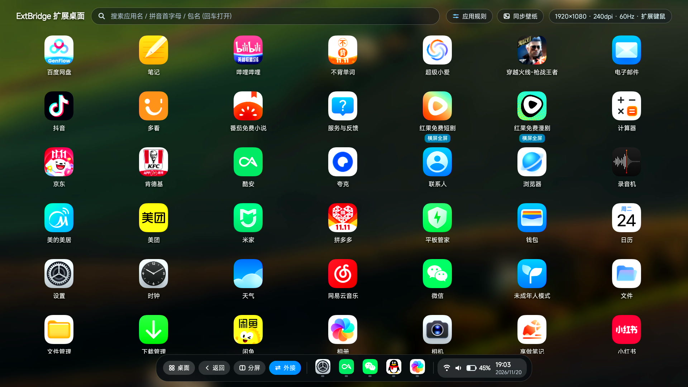
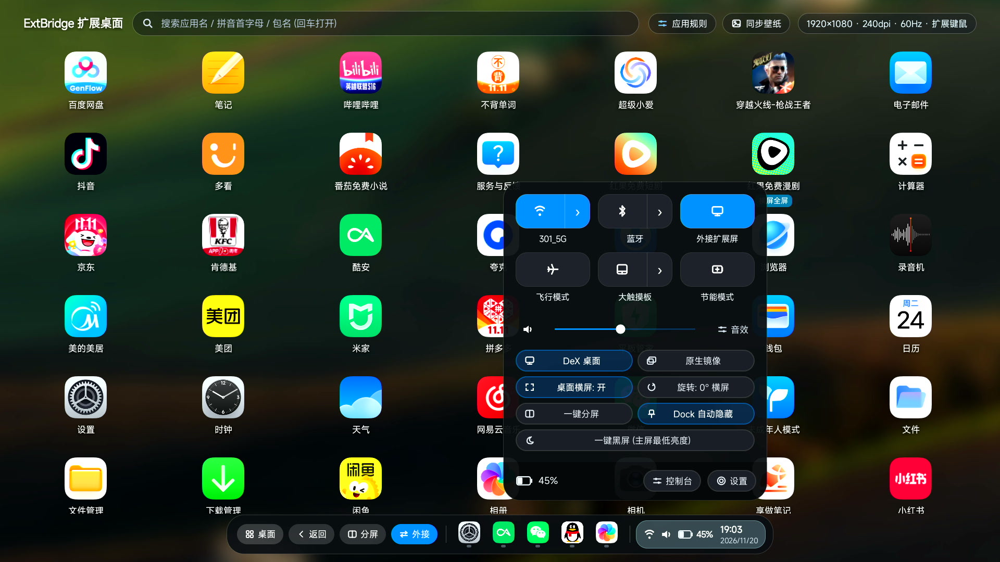
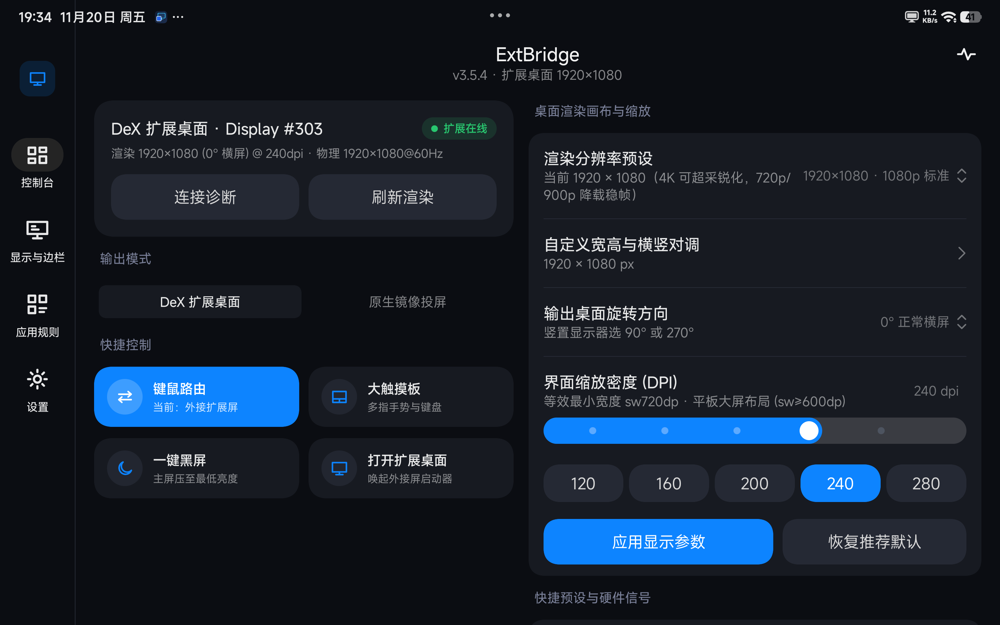
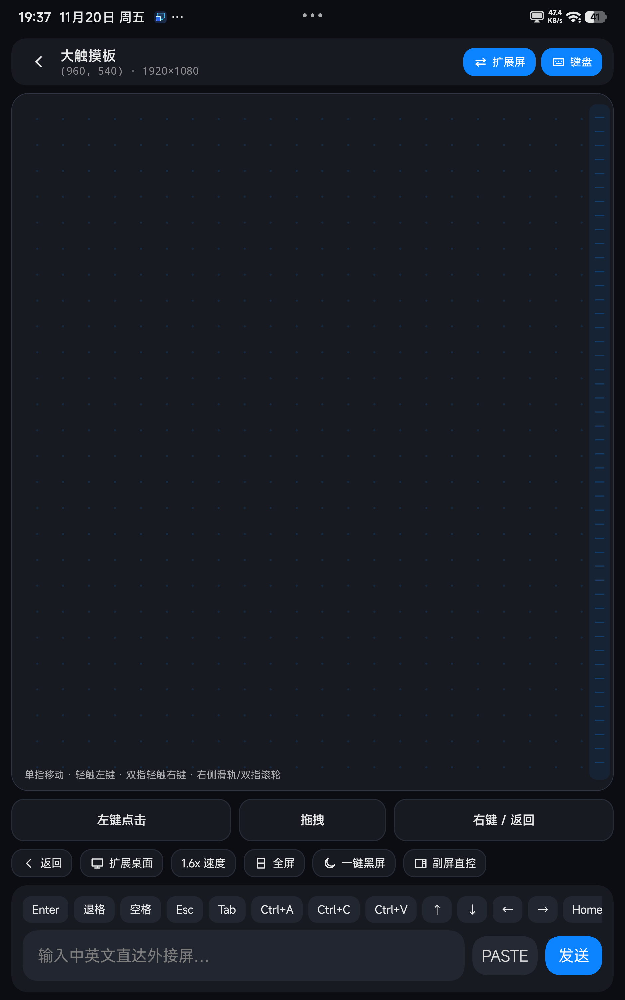

# ExtBridge Lite (`v3.4.2-lite`) — Miuix 界面的跨系统扩展桌面

> 本分支将主控台和触摸板迁移为 Compose + Miuix 0.9.4，并更新激活流程与守护进程协议验证；Lite 显示内核、Dock 和外接桌面不变。

> **无需 Root · 单个 APK 自激活 · 面向多品牌 Android 系统（ColorOS / OriginOS / Flyme / 类原生 AOSP / HyperOS 等）的高兼容纯净分支 · [📖 使用说明书](docs/USER_GUIDE.md) · [📝 v3.4.2-lite 分支说明](docs/RELEASE_v3.4.2-lite.md)**

`lite` 分支基于主线 `v3.4.2` 裁剪构建，**彻底移除了对底层非公开隐藏接口耦合最重的「镜像信息侧边栏 / 双虚拟屏 / 边缘鼠标捕获 / AppWidget 宿主」模块**，同时**完整保留了 DeX 独立扩展桌面、自由分屏、Dock 自动隐藏、主屏一键黑屏省电与纯净原生镜像切换**，并增强了跨品牌 Android 11–16 系统的接口签名自适应与权限引导。

> 如需完整的「原生镜像黑边信息副屏 + 14 种预设卡片 + 系统桌面小组件 + 物理鼠标跨屏操控」功能，请切换至仓库 `main` 主分支。

---

## ✨ 核心特性 (`v3.4.2-lite`)

### 1. 🖥️ 真·双屏独立 DeX 扩展桌面 + 21:9 带鱼屏自适应
- 自动探测外接物理显示器 (`Display.TYPE_EXTERNAL`) 并通过 `SurfaceControl` 投射独立的 `VirtualDisplay`（首次接入自动从 EDID 优先识别 `≥50Hz` 最高原生宽屏物理分辨率与适配 DPI，避免 3:2 平板默认回落到 4:3/16:9 留黑边）。
- **独立「桌面渲染分辨率」调节与四向旋转（`0° / 90° / 180° / 270°`）**：内置 `3840×2160 (4K)`、`3440×1440 (21:9 准4K带鱼)`、`2560×1600`、`2560×1440`、`2560×1080 (21:9 带鱼)`、`1920×1200`、`1920×1080`、`1600×900`、`1280×720` 预设及自定义宽高比，「恢复推荐默认」自动匹配当前显示器最佳原生 EDID 分辨率。
- **纯净原生镜像一键切换**：在 DeX 独立桌面与纯净居中原生镜像间一键无缝切换（不创建第二虚拟屏、无后台轮询，若定制 ROM 无 `mirrorDisplay` 接口则自动回退系统原生镜像）。

### 2. 🌙 一键黑屏（平板/手机主屏最低亮度省电护眼）
- 在外接屏 Dock 快捷控制浮窗、主控制台首页或虚拟触摸板底部点击 **「🌙 一键黑屏」**：
  - **DeX 模式下**：主屏立即叠加纯黑防误触遮罩（支持 `NavAssistService` 无障碍层级兜底）并将物理背光压至硬件最低值 `1`；**双击主屏任意位置**、关闭服务或拔掉外接屏时自动精确还原进入前的亮度。
  - **纯净镜像模式下**：仅将本机内屏硬件背光压至最低（不盖黑窗，确保外接显示器/电视画面正常高亮），再点立即恢复。

### 3. ◫ DeX 自由分屏模式 & Dock 自动隐藏
- **横屏自动左右分屏 / 竖屏自动上下分屏**：Dock `◫ 分屏` 一键配对最近两个应用，或在桌面长按/右键图标选择放入左/右/上/下屏；中央拖拽分割条支持 **`25% ~ 75%`** 实时调节比例与 `3:7 / 4:6 / 5:5 / 6:4 / 7:3` 快捷预设、一键互换与退出。
- **自适应自动隐藏 Dock 栏 & Win11 风格快捷浮窗**：进入应用闲置约 `2.6s` 自动平滑收起为底边触发条，鼠标移至底边即刻唤醒。
- **三档分应用显示兼容 + 防悬浮小窗劫持**：支持 *跟随系统默认 / 强制横屏全屏 / 竖屏居中兼容*，自动锁定扩展屏 `WINDOWING_MODE_FULLSCREEN` 容器，防止工作台/强制桌面模式将应用误转为不可鼠标拖拽的小窗。

### 4. 🛡️ 专为多品牌 Android 系统优化的兼容性设计
- **零副屏 / 零边缘抢焦点开销**：完全去除第二虚拟屏 `sSideVd`、`IInputManager.getCursorPositionInLogicalDisplay` 轮询、透明 `PointerCapture` 捕获页、`IAppWidgetService` 反射授权及周期性 `dumpsys audio/media_session` 调用。
- **跨 Android 11–16 方法签名自适应 + CLI 兜底**：`IActivityTaskManager.startActivity` 自动兼容 10 参数（Android 11）与 11 参数（Android 12–16）签名，并在深度魔改 ROM 上自动回退 `am start --display` 命令。
- **分品牌权限智能提示**：当输入注入被系统拦截 (`INJECT_EVENTS`) 时，自动识别品牌提示对应开关（如小米/REDMI「USB 调试（安全设置）」、OPPO/一加/真我 ColorOS「禁止权限监控」、vivo/iQOO「USB 模拟点击」）。
- **激活链路安全加固**：内置 adb 服务只监听应用私有 `0700` Unix Socket（不再暴露本机 TCP 端口），激活结束即在 `finally` 中 `kill-server`；守护进程对 `com.extbridge.helper` 做官方签名证书指纹校验（`getVerifiedHelperUid`），`ControlReceiver` 仅接受持有 `INJECT_EVENTS` 签名权限的调用方；小米必需的 `appops 10021` 与 `deviceidle whitelist` 由部署脚本自动补齐。
- **小米分身 / 未开安全设置下的部署可靠性**：无线调试改为 `adb push` 直传 JAR，APK 内 `assets/extbridge.jar` 以 `noCompress` 原样存储，并在构建期做 d8 ZIP 头归一化，避免 `pm path` + `unzip` 在受限 ROM 上失败。

---

## 📸 实机效果展示

| DeX 独立扩展桌面 & Dock | Win11 快捷浮窗 & 一键黑屏入口 | 主屏一键黑屏最低亮度保护 |
| :---: | :---: | :---: |
|  |  |  |

| 短剧等应用强制横屏全屏 | DeX 50/50 自由分屏模式 | 主控制台与增强虚拟触摸板 |
| :---: | :---: | :---: |
|  |  |   |

---

## 🏗️ 架构与目录结构（Lite 纯净分支）

```text
├── bridge/                                  # Shell 权限后台守护进程（app_process 启动）
│   └── src/com/extbridge/daemon/
│       └── ExtBridge.java                   # 物理屏接管、单 VirtualDisplay 投射、纯净镜像合成、
│                                            # 分屏/键鼠注入、一键黑屏调光、跨系统反射兼容
├── helper/                                  # Android 客户端 App (com.extbridge.helper)
│   ├── AndroidManifest.xml                  # 组件与权限声明；版本配置在 build.gradle.kts
│   ├── jniLibs/arm64-v8a/libadb.so          # 内置 arm64 adb 二进制，供免电脑无线调试自激活使用
│   ├── res/
│   └── src/com/extbridge/helper/
│       ├── MainActivity.kt                  # Miuix 控制台（导航/显示/规则/设置/权限与激活抽屉）
│       ├── LauncherActivity.java            # 外接屏独立桌面启动器（壁纸同步、拼音检索、分屏/兼容菜单）
│       ├── BridgeService.java               # 前台服务（Dock、快捷浮窗、分屏分割条、黑屏遮罩、光标）
│       ├── TouchpadActivity.kt              # Miuix 触摸板控件 + 原生手势区域、软键盘输入转发
│       ├── BridgeClient.java                # Binder IPC 客户端与多品牌权限提示工具
│       ├── BridgeProvider.java              # 安全分发 Binder 句柄（UID 白名单鉴权）
│       ├── ActivationFlow.java              # 激活状态机（校验→配对→连接→部署→验证，可独立测试）
│       ├── ActivationSession.java           # 激活并发/取消/所有权票据
│       ├── DaemonLaunchScript.java          # Root/无线/电脑三路共用的失败关闭部署脚本
│       ├── DaemonProtocol.java              # 守护进程 Binder 事务码与存活探测常量
│       ├── ControlReceiver.java             # 签名权限保护的广播接收器（通知按钮走 Internal 变体）
│       ├── NavAssistService.java            # 无障碍辅助服务（高优先级黑屏遮罩、浮层与手势穿透）
│       ├── AdbBootstrap.java                # mDNS 发现 + 位于应用私有 0700 Unix Socket 的内置 adb
│       └── AdbPairingReceiver.java          # 通知栏 6 位配对码快捷响应
├── docs/
│   ├── USER_GUIDE.md                        # Lite 纯净版图文使用说明书
│   ├── RELEASE_v3.4.2-lite.md               # Lite 分支更新与裁剪说明
│   └── images/                              # 实机功能截图
├── .github/workflows/build.yml              # GitHub Actions 自动构建与 Release 工作流
└── build_v3.ps1                             # Windows 一键编译 Lite daemon + Gradle 客户端 (JDK 21+)
```

---

## 🚀 快速上手

1. 安装 APK，首次打开按引导授予 **通知**、**悬浮窗** 与 **无障碍服务 (`ExtBridge 平板辅助手势`)** 权限。
   - **小米 / REDMI**：建议在开发者选项开启「USB 调试（安全设置）」；
   - **OPPO / 一加 / 真我 (ColorOS)**：建议在开发者选项开启「禁止权限监控」；
   - **vivo / iQOO (OriginOS)**：建议在开发者选项开启「USB 模拟点击 / 允许模拟输入」。
2. 选择 **本机无线调试通知栏填 6 位配对码**、**电脑 ADB 一键命令** 或 **Root 一键降权激活** 拉起守护进程。
   - 电脑方式：连接设备并允许 USB 调试，在激活页复制明文单行命令。它先通过 `--verify-helper` 校验已安装应用的官方签名，再替换旧服务并授权。`EXTBRIDGE_PC_READY` 表示本次启动的进程已存活，无需保持 App 界面打开；Binder 握手状态可在 App 中查看。
   - `getDaemonStatus` 是独立诊断接口。若尚未确认连接（如 App 进程刚重启），返回 `connection_state=UNKNOWN` 并请求重新交付 Binder；此时旧字段 `connected=false` 不代表守护进程已停止。
   - Root 只负责读取 JAR（独立挂载命名空间下会从已安装的 APK 回退提取）。接收端以 shell 身份校验 JAR 的 SHA-256 和应用签名；App 通过进程管道分别批准替换旧服务、保留新进程。取消发生在批准替换前时会保留旧服务；批准替换后取消只会清理本次启动的新进程。
   - 配对完成不等于激活完成；以软件显示的验证结果为准。
3. 插入 Type-C 显示器即可体验 **DeX 独立扩展桌面、自由分屏、一键黑屏省电与纯净原生镜像切换**。

---

## 🏗️ 本地构建

需要 JDK 21+，以及 Android SDK `platforms;android-37.0` 和 `build-tools;37.0.0`。
设置 `JAVA_HOME` 与 `ANDROID_HOME` 后，在 Windows PowerShell 执行：

```powershell
.\build_v3.ps1 -Configuration Debug
```

脚本先构建 daemon JAR，再构建客户端。Debug APK 输出到 `build/out/exthelper.apk`，使用开发测试证书，可验证界面和部署失败路径，不能通过正式激活的签名校验。
生成 daemon JAR 后，也可以通过 Gradle 构建并安装客户端：

```powershell
.\gradlew.bat :helper:installDebug
```

新克隆项目或修改 `bridge/` 后，应先重新运行 `build_v3.ps1`；Gradle 不负责重新编译 daemon。
默认 Release 构建保留 R8 与资源缩减，配置 `EXTBRIDGE_KEYSTORE`、`EXTBRIDGE_KEYSTORE_PASS` 时签名并核对最终 APK 的官方证书 SHA-256；
未配置密钥时输出 `build/out/exthelper-unsigned.apk`，不会自动替换为 Debug 签名。
`helper/build.gradle.kts` 的 `versionCode` 保持在主线正式版之下（当前 `26`，按评审要求 ≤27，主线现为 `29`），确保用户能从 Lite 覆盖安装回官方主线版本。
`.github/workflows/build.yml` 已与主线同步：JDK 21 / `platforms;android-37.0` + `build-tools;37.0.0`、仓库身份保护、Release 仅限官方主仓触发，产物命名 `ExtBridge_v<version>[-unofficial-fork-<owner>].apk`。

---

## ⚠️ 开源协议
基于 [MIT License](LICENSE) 开源。
