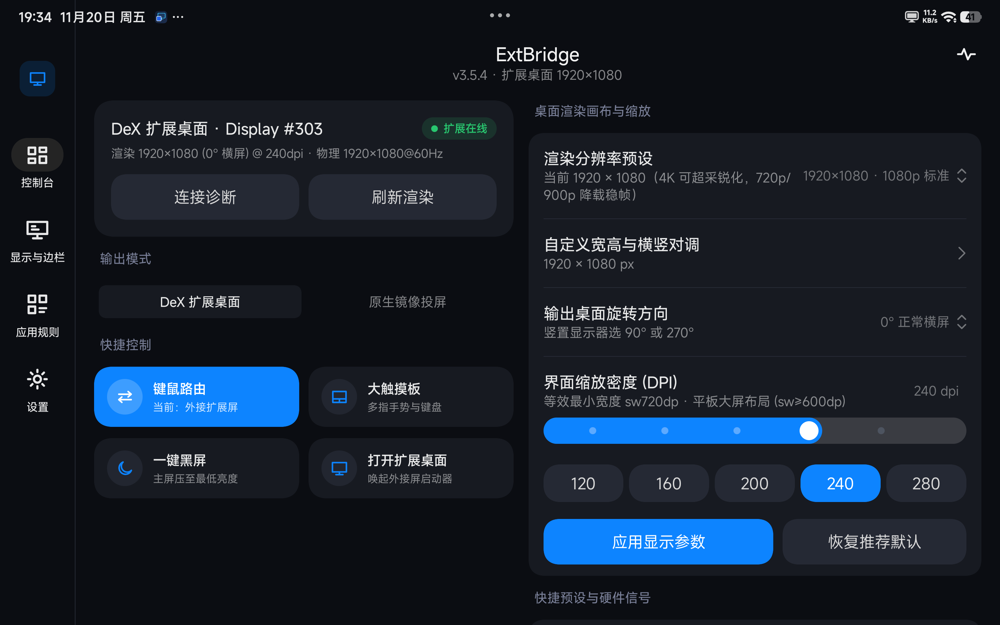
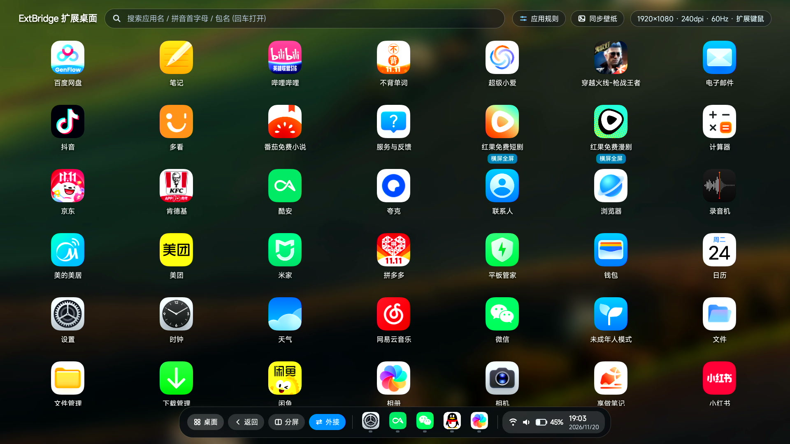
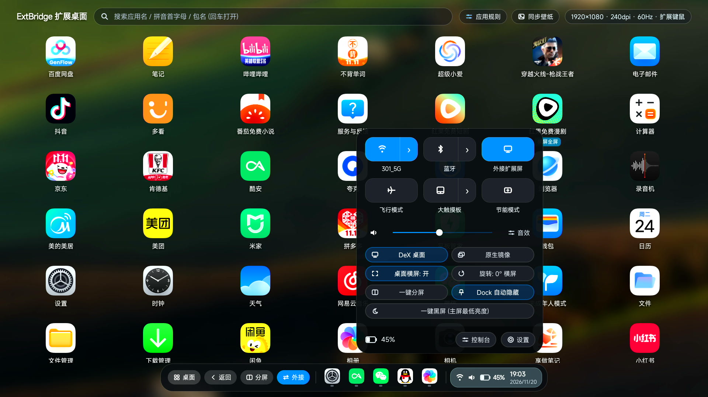
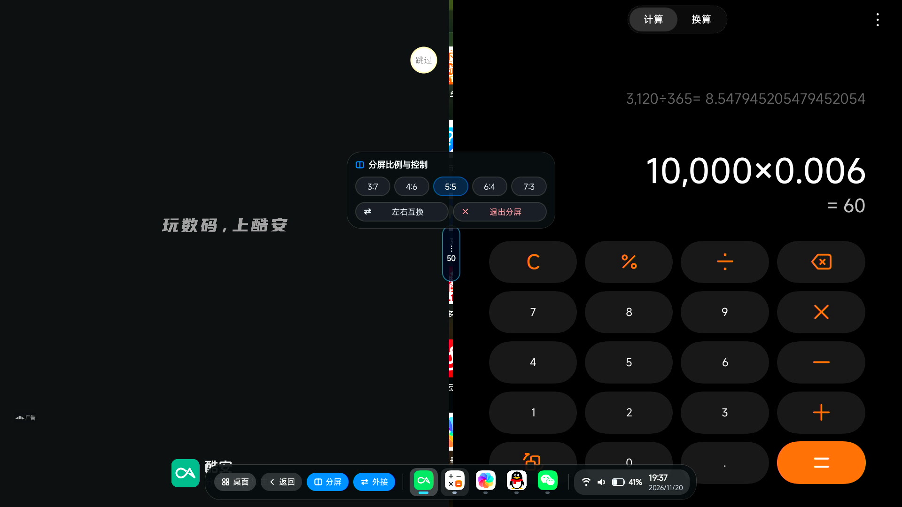
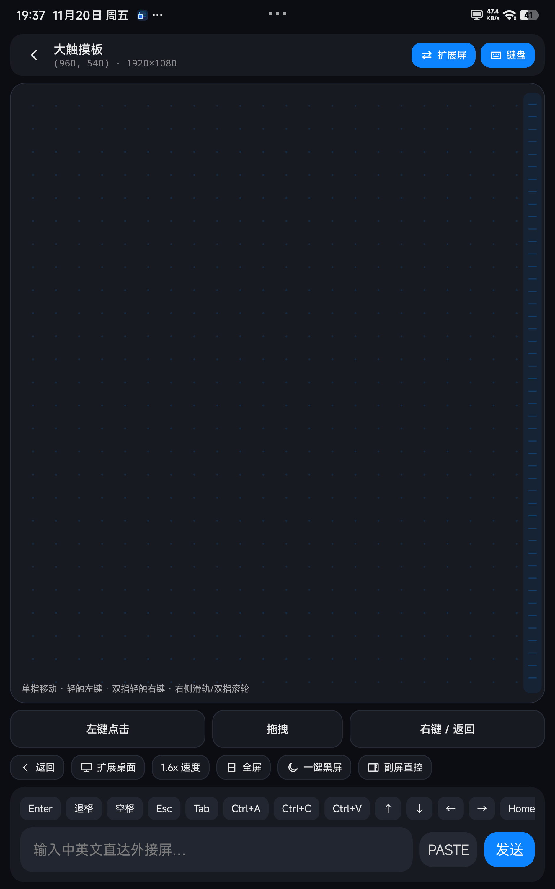

# ExtBridge Lite 使用说明书 (`v3.4.2-lite` 跨系统纯净版)

> **无需 Root · 单个 APK 自激活 · 专注「DeX 独立扩展桌面 + 自由分屏 + 一键黑屏省电 + 纯净镜像切换」的高兼容分支**

---

## 1. 环境准备与各品牌开发者开关

- **适用设备**：支持 USB-C DP Alt Mode 视频输出的 Android 11+（ARM64）手机与平板（尤其适合 **vivo OriginOS、OPPO/一加 ColorOS、魅族 Flyme、类原生 AOSP、小米 HyperOS** 等默认仅提供镜像的机型；若设备自带三星 DeX / 华为电脑模式 / 联想超级互联，请先在系统设置中将外接模式切为“仅镜像”）。
- **首次启动必需权限**：**通知权限**、**悬浮窗权限**、**无障碍服务 (`ExtBridge 平板辅助手势`)**。
- **允许模拟点击注入（如遇鼠标有移动动画但点不动图标）**：
  - **小米 / REDMI (HyperOS)**：开发者选项 → 开启 **「USB 调试（安全设置）」**
  - **OPPO / 一加 / 真我 (ColorOS)**：开发者选项 → 开启 **「禁止权限监控」**
  - **vivo / iQOO (OriginOS)**：开发者选项 → 开启 **「USB 模拟点击 / 允许模拟输入」**

---

## 2. 激活后台守护进程（三种方式）

1. **免 Root · 本机无线调试自激活**：开启系统「无线调试」→ 点击弹窗「发送快捷配对通知」→ 在无线调试「使用配对码配对设备」页面查看 6 位配对码，下拉通知栏直接输入即可。
2. **免 Root · 电脑 ADB 一键激活**：连接电脑执行弹窗或 `README.md` 中的单行 `adb shell` 命令。
3. **已 Root 设备**：选择 Root 激活。Root 只读取守护进程 JAR，校验和启动均以 `uid=2000 (shell)` 执行。若无法降权、JAR 哈希不符或当前用户的应用签名不是官方证书，激活会在替换旧服务前停止。

---

## 3. 主控制台与分辨率 / 21:9 带鱼屏设置

- 支持 `3840×2160 (4K)`、`3440×1440 (21:9 准4K)`、`2560×1600`、`2560×1440`、`2560×1080 (21:9 带鱼)`、`1920×1200`、`1920×1080`、`1600×900`、`1280×720` 及自定义宽高与四向旋转（`0° / 90° / 180° / 270°`）。
- 点击 **「↺ 恢复推荐默认」** 会自动识别当前外接显示器 EDID 中 `≥50Hz` 的最高原生面板分辨率并同步下发。
- 点击顶部 **「📺 原生镜像」** 与 **「🖥 DeX 扩展」** 可随时在独立桌面与纯净同屏镜像间无缝切换。

---

## 4. DeX 独立桌面、一键黑屏与自由分屏

### 4.1 独立桌面与分应用显示兼容策略

长按或鼠标右键桌面图标可为单应用配置 *跟随系统默认 / 强制横屏全屏 / 竖屏居中兼容*：

### 4.2 Dock 栏、快捷控制浮窗与一键黑屏省电

点击 Dock 右下角状态区呼出快捷面板，点击 **「🌙 一键黑屏 (平板最低亮度)」**（也可直接在主控制台或虚拟触摸板点击 **`🌙 一键黑屏`**）：

开启后主屏覆盖纯黑防误触遮罩并将亮度压至硬件最低值 `1`；**双击主屏幕任意位置**、停止服务或拔线时自动恢复原亮度：

### 4.3 DeX 自由分屏模式（横屏左右 / 竖屏上下）

- 点击 Dock **`◫ 分屏`** 或桌面右键/长按图标放入左/右（竖屏为上/下）屏，拖拽中央分割手柄可在 **`25% ~ 75%`** 范围实时调节双窗口占比，轻点手柄可一键选预设比例、互换位置或退出分屏。

---

## 5. 增强虚拟触摸板与软键盘转发

支持单指移动、轻触左键、双指右键、双指/右边缘滚轮、拖拽锁定、`0.6x ~ 2.4x` 指针倍速、一键黑屏与软键盘中英文输入直达扩展屏焦点应用。

---

## 6. 快捷广播 Action 列表

| Action 名称 | 说明 |
| :--- | :--- |
| `com.extbridge.helper.TOGGLE_INPUT` | 切换外接键鼠控制屏幕 |
| `com.extbridge.helper.TOGGLE_MIRROR` | 切换 DeX 扩展桌面 / 纯净原生镜像 |
| `com.extbridge.helper.LAUNCH_EXT_HOME` | 返回扩展屏桌面主页 |
| `com.extbridge.helper.SPLIT_ACTION` | 触发或调节 DeX 分屏 |
| `com.extbridge.helper.SET_ROTATION` | 设置旋转角度 (`--ei rotation 0..3`) |
| `com.extbridge.helper.SET_DOCK_AUTO_HIDE` | 开关 Dock 自动隐藏 (`--ez auto_hide true/false`) |
| `com.extbridge.helper.REBUILD` | 重建扩展屏输出 |
| `com.extbridge.helper.EXIT_ALL` | 恢复亮度并彻底退出服务与守护进程 |
